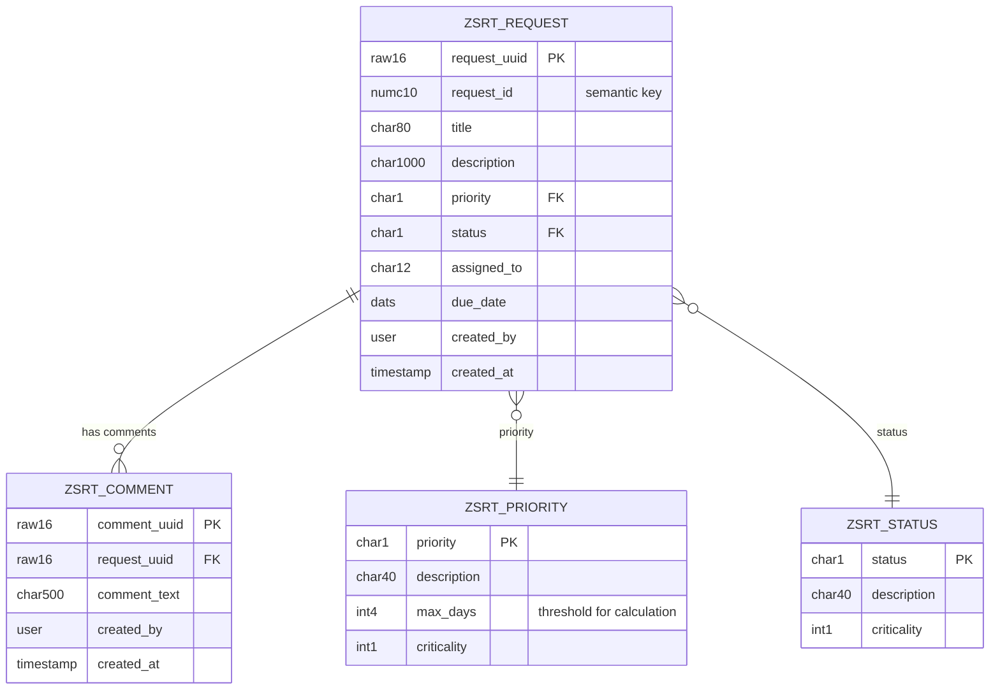

# Service Request Tracker

A maintenance ticketing app built with the **ABAP RESTful Application Programming Model (RAP)** in **ABAP Cloud** on SAP BTP.
Employees report issues (broken air conditioning, network outage, ...), technicians pick them up, escalate them and close them.

It covers the complete RAP stack end to end:

| Layer | What is implemented |
|---|---|
| **ABAP Cloud** | Released APIs only, business logic in classes (`ZCL_SRT_PRIORITY_CALCULATOR`) |
| **CDS views** | Root/child view entities with composition and associations, projection views, value-help views |
| **RAP business object** | Parent-child BO: Request → Comments |
| **Behavior definition** | Managed implementation, draft handling, managed UUID numbering, determinations, validations, actions, feature control, side effects |
| **Authorization** | CDS access controls (DCL) + global and instance authorization in the BO |
| **OData** | Service definition + OData V4 UI service binding |
| **Fiori elements** | List report + object page purely from metadata extensions (UI annotations) |
| **Unit tests** | ABAP Unit with CDS and SQL test doubles for the BO and the calculator class |

## Features

- **Create / edit / delete** service requests with **draft** support (work is never lost, edits can be resumed)
- **Request number** drawn automatically on save (`0000000001`, `0000000002`, ...)
- **Validations**: title is mandatory, due date is mandatory and must not be before the creation date, comments must not be empty
- **Determinations**:
  - Initial status *New*, switches to *In Progress* as soon as someone is assigned
  - **Priority calculated from the due date** using thresholds from a configuration table (≤ 2 days → High, ≤ 7 days → Medium, otherwise Low)
- **Actions**:
  - **Assign to Me** – takes over the request
  - **Escalate** – status *Escalated*, priority *Critical*
  - **Close** / **Reopen**
- **Feature control**: actions are only offered when they make sense; a closed request is read-only until it is reopened
- **Instance authorization**: everybody can work on a request, only the requester can delete it
- **Comments** as a child entity (composition), edited together with the request in the same draft

## Data model



| Status | Meaning | | Priority | Rule |
|---|---|---|---|---|
| `N` New | nobody assigned | | `1` Critical | only via *Escalate* |
| `P` In Progress | assigned | | `2` High | due in ≤ 2 days (or overdue) |
| `E` Escalated | set by *Escalate* | | `3` Medium | due in ≤ 7 days |
| `C` Closed | set by *Close* | | `4` Low | later |

## Architecture

```
ZUI_SRT_REQUEST_O4          Service binding (OData V4 - UI)
└── ZUI_SRT_REQUEST         Service definition
    ├── ZC_SRT_Request      Projection (root)      + ZC_SRT_REQUEST  BDEF projection, DDLX UI annotations, DCL
    │   └── ZC_SRT_Comment  Projection (child)     + DDLX, DCL
    ├── ZI_SRT_Priority_VH  Value help
    └── ZI_SRT_Status_VH    Value help

ZR_SRT_Request              Root view entity       + ZR_SRT_REQUEST  BDEF (managed, draft), DCL
└── ZR_SRT_Comment          Child view entity      + DCL
    ZBP_R_SRT_REQUEST       Behavior pool (handlers lhc_request, lhc_comment + ABAP Unit tests)
    ZCL_SRT_PRIORITY_CALCULATOR   Business logic for the priority (+ ABAP Unit tests)
    ZIF_SRT_CONSTANTS       Status and priority codes
    ZCL_SRT_DATA_GENERATOR  Fills configuration + demo data (console app)

Tables: ZSRT_REQUEST, ZSRT_COMMENT (active), ZSRT_D_REQUEST, ZSRT_D_COMMENT (draft),
        ZSRT_PRIORITY, ZSRT_STATUS (configuration)
```

## Installation

You need an ABAP Cloud system, for example the free **SAP BTP Trial – ABAP environment** or the **ABAP Cloud Developer Trial**.

1. In ABAP Development Tools create a package, e.g. `ZSRT` (in the trial: below `ZLOCAL`).
2. Open the view **abapGit Repositories**, click **Link New abapGit Repository** and enter
   `https://github.com/aurelianv1/ServiceRequestTracker.git`, target package `ZSRT`.
3. **Pull** the repository and **activate** all inactive objects (Ctrl+Shift+F3).
4. Open class `ZCL_SRT_DATA_GENERATOR` and run it with **F9** – this fills the configuration tables and creates six demo requests.
5. Open service binding `ZUI_SRT_REQUEST_O4`, click **Publish**, select entity `ServiceRequest` and click **Preview** – the Fiori elements app opens in the browser.

> The BTP trial is shared by many users, so object names have to be unique. If a pull fails because `ZSRT_*` objects already exist, rename the prefix (e.g. `ZSRT_AA_*`).

## Running the tests

Right-click the package → **Run As → ABAP Unit Test** (Ctrl+Shift+F10).

- `ZBP_R_SRT_REQUEST` – 9 tests on numbering, status and priority determination, validations, actions and feature control, using `CL_CDS_TEST_ENVIRONMENT` (BO test doubles) and `CL_OSQL_TEST_ENVIRONMENT` (configuration table double)
- `ZCL_SRT_PRIORITY_CALCULATOR` – 6 tests on the threshold logic, including the fallback when the configuration is empty

## Screenshots

_To be added after the first deployment: list report, object page, draft editing, escalate action._
